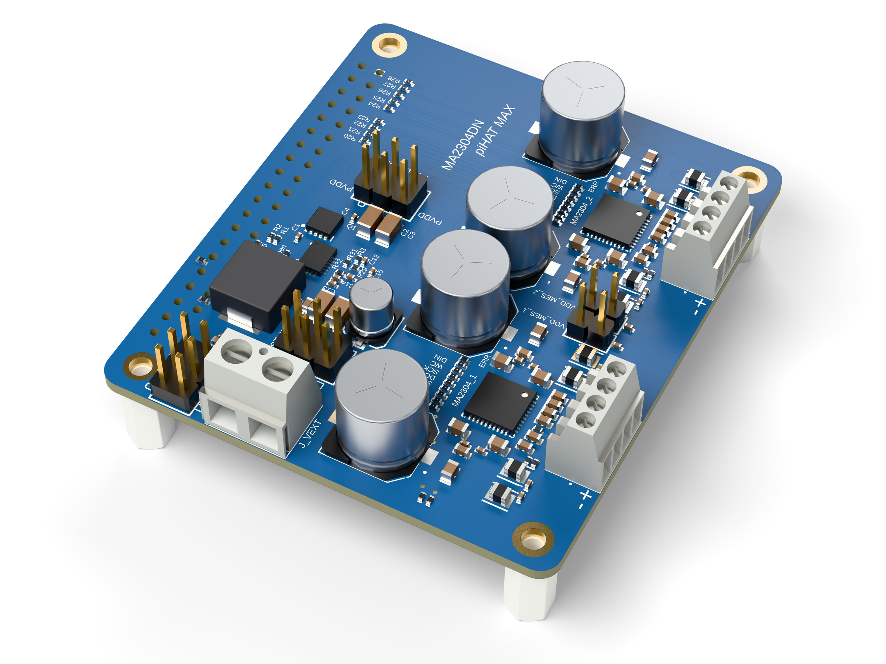

# kit-18v-amp-hat-ma2304

A Raspberry Pi sound card with two MA2304xNS Class-D amplifiers and an MP3428 boost converter that powers the amps from a single- or dual-cell battery. For portable and mains powered applications.

